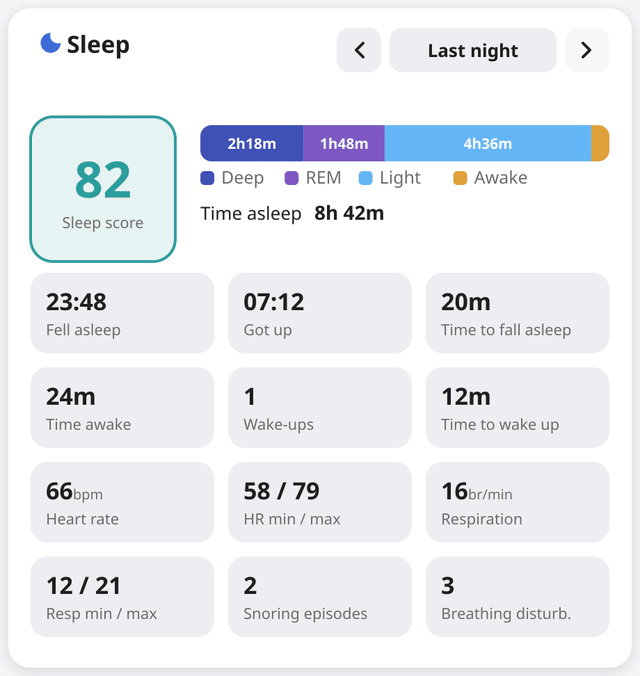
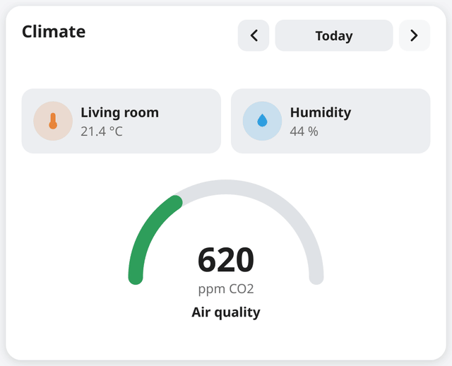

# Time Machine Card

A generic "back in time" wrapper card for Home Assistant Lovelace dashboards.

It wraps any other card and feeds that card a patched `hass` object in which
the entities you list hold the value they had on a selected past date. Because
regular cards render from `hass.states[entity_id]`, this makes state-reading
cards (tile, gauge, glance, entities, markdown, and most custom cards) display
historical data without any modification to those cards.

It is the reusable generalisation of the trick the Energy dashboard uses: a
date selector that rewinds what the cards show. Home Assistant exposes no card
that does this for arbitrary sensors, and templating cannot read a sensor's
value as of a past date, so a wrapper that patches `hass` is the clean way to
do it.

## Examples

Wrapping a custom sleep card and stepping through past nights (fake data):



Wrapping standard Home Assistant cards, two tile cards and a gauge (generic data):



## How it works

1. The wrapper owns a selected date with previous / today / next controls.
2. On a past date it fetches each listed entity's value as of the end of that
   day, from the recorder: raw history first, then daily long-term statistics
   for dates older than the recorder retention window.
3. It clones `hass`, overrides `state` (and `last_changed` / `last_updated`)
   for the listed entities, and hands that clone to the child card.
4. On "today" it passes the live `hass` unchanged, so the child is fully live
   and interactive.

## Installation

### HACS (custom repository)

1. In HACS, open the three-dot menu and choose Custom repositories.
2. Add `https://github.com/Frosbe/lovelace-time-machine-card` with category
   Dashboard (Lovelace).
3. Install Time Machine Card, then reload your browser.

### Manual

1. Copy `time-machine-card.js` to `config/www/`.
2. Add a dashboard resource of type JavaScript Module pointing at
   `/local/time-machine-card.js`.

## Usage

```yaml
type: custom:time-machine-card
title: Sleep
entities:
  - sensor.sleep_score
  - sensor.deep_sleep
card:
  type: tile
  entity: sensor.sleep_score
```

Wrap several cards at once with `cards:` instead of `card:`:

```yaml
type: custom:time-machine-card
entities:
  - sensor.weight
cards:
  - type: tile
    entity: sensor.weight
  - type: gauge
    entity: sensor.weight
```

## Options

| Option     | Type        | Required | Description                                                      |
| ---------- | ----------- | -------- | ---------------------------------------------------------------- |
| `type`     | string      | yes      | `custom:time-machine-card`                                       |
| `entities` | list        | yes      | Entities to rewind. The wrapper cannot infer them from the child |
| `card`     | card config | one of   | A single child card to wrap                                      |
| `cards`    | list        | one of   | Several child cards (wrapped in a vertical stack)                |
| `title`    | string      | no       | Optional label shown next to the date controls                   |

## Behaviour and limitations

- You must list the entities to rewind. The wrapper does not parse the child
  config, so it cannot know which entities a nested child uses.
- Graph and history cards (history-graph, statistics-graph, mini-graph,
  apexcharts) fetch their own history window and will not follow the selected
  date. This wrapper only rewinds current state.
- On a past date the child's controls are locked (taps, toggles, sliders are
  disabled) so they cannot act on the live entity. On "today" the child is
  fully interactive.
- Dates older than the recorder retention window use daily statistics, which
  are approximate for the exact value and carry no wall-clock timestamp.
- The wrapped child is rendered without its own card shadow or border so it
  blends into the wrapper.

## License

MIT. See [LICENSE](LICENSE).
